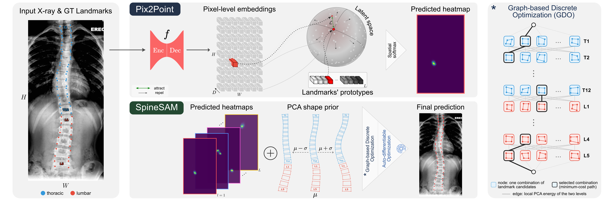

# Pix2Point: Dense Contrastive Learning for Anatomical Landmark Detection

This repository contains the codebase to reproduce the AASCE experiments of **Pix2Point**. It consists of the detection of
68 landmarks (the four vertebral-body corners of T1 to L5) on coronal (Antero-Posterior) spine X-rays.



*Figure 1: Overview of the full method. **Note that this repository only covers the
Pix2Point panel** (top centre): the encoder-decoder f, the pixel embeddings,
the landmark prototypes and the predicted heatmaps. The SpineSAM post-processing
(bottom: PCA shape prior and graph-based discrete optimisation, detailed on
the right) is **not** part of this codebase; all results reported here are
obtained without it. The figure is adapted for AASCE: the input image (left)
is an AASCE test radiograph with its 68 ground-truth corners (thoracic in
blue, lumbar in red), and the shape prior and graph run from T1 to L5. The
final prediction shown bottom right is the output of the full method, with
SpineSAM.*

**How it works.** An encoder-decoder network *f* (a 2D nnU-Net) maps the
image to 512-D pixel embeddings. Each landmark is associated to a learned
prototype in the same space. A landmark's heatmap is the similarity between
its prototype and every pixel embedding. Training pulls the pixel embedding
of the ground-truth pixel towards the prototype and pushes the other pixels
away (cross-entropy of the spatial softmax). The predicted landmark is the
maximum of its heatmap, with no post-processing.

Optionally, the network can be first **pre-trained via dense self-supervised learning**, following Pix2Rep-v2 pre-training recipe (MICCAI 2026, https://arxiv.org/abs/2609.01427v1).

## Contents

| task | script | needs |
|---|---|---|
| **Inference** on the 126 AASCE test images, with metrics | `predict.py` | data + a trained model |
| **Training from scratch** | `train.py` | data |
| **Training from a pretrained backbone** | `train.py --pretrained-backbone` | data + pretrained backbone (released, or from `pretrain.py`) |
| **Self-supervised pretraining** of the backbone | `pretrain.py` | data |

The repository contains no image and no trained model: the AASCE data are
**not** provided (see [Data](#data) section), and the only released weights, those of
the self-supervised pretrained backbone, can be downloaded separately (see
[Weights](#weights) section).

Codebase structure:
```
pix2point/                        repository root
├── pix2point/                    Python package
│   ├── config.py                 all experimental settings
│   ├── dataset.py                image / label loading, augmentations, data loaders
│   ├── unet_nnunet.py            backbone network f
│   ├── model.py                  prototype head, training and pretraining loops
│   └── landmark_schema_aasce.json  order of the 68 landmarks
├── prepare_aasce.py              preprocessing of the official AASCE release
├── splits/aasce_{train,val}.txt  frozen train / validation split
├── data_invalid/            the 12 AASCE images excluded from the experiments (JSON lists)
├── weights/                      pretrained backbone, once downloaded (not versioned)
├── predict.py                    inference + evaluation
├── train.py                      supervised training
├── pretrain.py                   self-supervised pretraining
├── evaluate.py                   metrics
├── slurm/                        cluster launchers
└── docs/                         figure 1
```

## Quick start

```bash
# 1. Environment (Python 3.12, PyTorch 2.13 with CUDA 12.6)
python3.12 -m venv .venv && source .venv/bin/activate
pip install -r requirements.txt --extra-index-url https://download.pytorch.org/whl/cu126

# 2. Data: preprocess the official AASCE release (see Data)
python prepare_aasce.py --aasce-root <AASCE_ROOT> --output-dir <DATA_ROOT>

# 3. Pretrained backbone (from Hugging Face, into weights/)
pip install huggingface_hub
huggingface-cli download <HF_REPO_ID> --include "*.pth" --local-dir weights

# 4. Training from the pretrained backbone (one GPU with >= 40 GB)
python train.py --data-root <DATA_ROOT> --output-dir runs/pretrained \
    --pretrained-backbone weights/pretraining/pretrained_backbone.pth

# 5. Inference and evaluation of the trained model (GPU, or CPU in ~3 min)
python predict.py --data-root <DATA_ROOT> --weights-dir runs/pretrained/train --output-dir runs/pretrained/test
```

Replace `<AASCE_ROOT>` with the official AASCE release and `<DATA_ROOT>` with
the output folder of `prepare_aasce.py` (see [Data](#data)).

## Data

The AASCE 2019 challenge data (coronal radiographs, 68 annotated corners per
image) are **not distributed with this repository**: they must be obtained
from the challenge organisers. `prepare_aasce.py` converts the official
release (`data/{training,test}/*.jpg`, `labels/{training,test}/*.jpg.mat`)
into the layout read by the other scripts:

```bash
python prepare_aasce.py --aasce-root <AASCE_ROOT> --output-dir <DATA_ROOT>
```

For each image: intensity normalisation between the 1st and 99th
percentiles, resize to fit 752 × 256 (aspect ratio kept), CLAHE contrast
enhancement, centred zero padding, saved as 8-bit NIfTI; the landmarks
undergo the same resize and padding, with the vertebrae sorted from top to
bottom (the order of the official files is not reliable). No cropping is
applied: the AASCE images are already cropped on the spine. All the fixed
constants are at the top of the script.

**Excluded images.** The official AASCE split has 481 training and 128 test
images. We removed 10 training and 2 test images whose annotations are
invalid: on each of them, the corners of two adjacent vertebrae are
misplaced with respect to each other (for instance crossed corners, or two
vertebrae overlapping). All experiments therefore use **471 training and 126
test images**.

These images were excluded **by visual inspection** of the annotations, not by
an automatic rule or threshold. They are listed in
`data_invalid/train.json` and `data_invalid/test.json`, with their
file name in the official AASCE release and the pair of vertebrae concerned:

| split | image | inconsistent pair |
|---|---|---|
| train | `sunhl-1th-06-Jan-2017-182_A_AP` | T10 / T11 |
| train | `sunhl-1th-10-Jan-2017-243_C_AP` | T1 / T2 |
| train | `sunhl-1th-25-Jul-2016-15_B_AP` | L4 / L5 |
| train | `sunhl-1th-25-Jul-2016-41_B_AP` | T6 / T7 |
| train | `sunhl-1th-25-Jul-2016-49_A_AP` | L2 / L3 |
| train | `sunhl-1th-25-Jul-2016-51_A_AP` | L4 / L5 |
| train | `sunhl-1th-25-Jul-2016-51_B_AP` | L4 / L5 |
| train | `sunhl-1th-25-Jul-2016-61_A_AP` | L4 / L5 |
| train | `sunhl-1th-26-Jul-2016-76_C_AP` | T1 / T2 |
| train | `sunhl-1th-30-Dec-2016-161_A_AP` | L4 / L5 |
| test | `sunhl-1th-01-Mar-2017-311_C_AP` | T1 / T2 |
| test | `sunhl-1th-01-Mar-2017-319_A_AP` | L4 / L5 |

Expected layout of `<DATA_ROOT>`:

```
<DATA_ROOT>/
├── train/                                  471 images (424 training + 47 validation)
│   ├── images_prepro_clahe/<subject>.nii
│   ├── labels/<subject>.json
│   └── cropping_info/<subject>_crop_info.json
└── test/                                   126 images
    ├── images_prepro_clahe/<subject>.nii
    ├── labels/<subject>.json
    └── cropping_info/<subject>_crop_info.json
```

- **Labels**: `{"Vertebre_T1": {"Plat_Sup_D": [x, y], ...}, ...}`, in pixels
  of the 752 × 256 image (`x` along the width). `Plat_Sup` / `Plat_Inf` =
  upper / lower endplate, `D` / `G` = right / left corner. The landmark order
  is fixed by `pix2point/landmark_schema_aasce.json`.
- **Cropping info**: maps the 752 × 256 frame back to the original
  radiograph, where the metrics (and the validation error used for early
  stopping) are computed:
  `x_orig = (x - pad_left) / resize_scale + left` (same for `y` with
  `pad_top` and `top`).
- **Split**: `splits/aasce_{train,val}.txt` list the 424 training and 47
  validation images; all views of a patient are on the same side.

## Weights

The weights of the **self-supervised pretrained backbone** are released,
on Hugging Face (`<HF_REPO_ID>`). From the root of this repository:

```bash
pip install huggingface_hub
huggingface-cli download <HF_REPO_ID> --include "*.pth" --local-dir weights
```

This gives `weights/pretraining/pretrained_backbone.pth`, the starting point
of "training from a pretrained backbone". It is a backbone only (no landmark
prototypes), produced by `pretrain.py`, so it cannot be used for inference by
itself. You can also choose to train Pix2Point from scratch, by skipping initialization from pre-trained weights.

## Inference and evaluation

```bash
python predict.py --data-root <DATA_ROOT> --weights-dir runs/scratch/train    --output-dir runs/scratch/test
python predict.py --data-root <DATA_ROOT> --weights-dir runs/pretrained/train --output-dir runs/pretrained/test
```

`--weights-dir` is the `train/` folder of a training run; by default the
checkpoint with the lowest validation error is used (`--checkpoint best_mre`).

Outputs in `--output-dir`:

- `aasce_test.csv`: predictions, one row `image_id,landmark_id,x,y` per
  landmark (752 × 256 pixels, landmark order of the schema);
- `metrics.json`: the metrics below (`mre_norm_pct`, `mre_norm_pct_std`, `sdr_1pct`).

**Metrics of the paper.** AASCE provides no pixel spacing information. Since image sizes can be very different, errors are
normalised by the subject's spine length (polyline from the top of T1 to the
bottom of L5 through the vertebral centres, on the ground truth), measured on
the original radiograph:

- **MRE_norm (%)**: mean radial error (Euclidean distance to the ground
  truth) in % of the spine length, ± standard deviation over the
  126 × 68 landmarks of the test set;
- **SDR@1% (%)**: percentage of landmarks whose error is at most 1 % of the
  spine length.

On the two private datasets (not part of this repository), the paper reports
instead the **MRE in mm ± standard deviation** and the **SDR@2mm**, on the
88 vertebral corners.

`evaluate.py` scores any prediction file in the same format:
`python evaluate.py --data-root <DATA_ROOT> --pred <file.csv> --out metrics.json`.

### Reported results

Rows "Pix2Point (from scratch)" and "Pix2Point (pre-trained)" of the ablation
table of the paper (AASCE test set, best validation-error checkpoint of one
training run each):

| model | MRE_norm (%) | SDR@1% (%) |
|---|---|---|
| Pix2Point, from scratch | 3.13 ± 4.10 | 47.1 |
| Pix2Point, pretrained backbone | 2.44 ± 2.62 | 50.9 |

The results of the full method (with the SpineSAM post-processing, 2.18 ±
2.48 % and 56.6 %) are not reproducible with this repository, which does not
contain SpineSAM.

## Training

```bash
# from scratch
python train.py --data-root <DATA_ROOT> --output-dir runs/scratch

# from the pretrained backbone (the only difference: the initial backbone weights)
python train.py --data-root <DATA_ROOT> --output-dir runs/pretrained \
    --pretrained-backbone weights/pretraining/pretrained_backbone.pth
```

Then evaluate the trained model with `predict.py` (see
[Inference and evaluation](#inference-and-evaluation)).

Settings (`CONFIG` in `pix2point/config.py`):

- seed 42, batch size 8, mixed precision;
- Adam, learning rate 1e-4 for the backbone and 1e-3 for the prototypes;
- at most 200 epochs, stopped when the validation error (MRE in pixels of
  the original radiographs) has not improved for 40 epochs;
- augmentations of the training images, each with probability 0.5: a random
  crop of 67–100 % of the image area resized back to 752 × 256 (random
  zoom-in) and a random rotation (± 5°); then blur, noise, gamma and
  brightness / contrast changes. No left–right flip, which would swap the
  left and right corners. With `random_crop = False`, the crop is replaced by
  a single affine transform: rotation (± 5°), translation (± 2 %) and zoom-in
  (scale in 1–1.5).

Prototype head options (`CONFIG`, also read back from the run's
`config.json` by `predict.py`):

| key | values |
|---|---|
| `prototype_mode` | `trainable` (default): prototypes are parameters trained end-to-end. `minibatch`: at each step, the prototypes are the embeddings of the landmarks in `num_prototypes` images drawn from the batch (excluded from the loss); for validation, the checkpoints and inference, they are the per-landmark spherical k-Means centroids of the embeddings of the training images, recomputed every epoch. |
| `proto_temperature_mode` | `unnormalized` (default): prototypes not L2-normalised, their norm acting as a learned inverse temperature (τ = 1); trainable prototypes only. `fixed`: normalised prototypes, τ = `proto_temperature` (0.1). `learned`: normalised prototypes, τ learned from `proto_temperature`, shared or per landmark (`proto_temperature_per_landmark`). |

Outputs in `<output-dir>/train/`:

| file | content |
|---|---|
| `unet_backbone_best_mre.pth` + `prototype_layer_best_mre.pth` | lowest validation error — **the model used for the reported results** (`predict.py` default) |
| `unet_backbone.pth` + `prototype_layer.pth` | lowest validation loss (`predict.py --checkpoint best_loss`) |
| `unet_backbone_last.pth` + `prototype_layer_last.pth` | last epoch (`predict.py --checkpoint last`) |
| `config.json`, `losses.png`, `val_distance.png` | settings and learning curves |
| `heatmaps_final/` | heatmaps of three landmarks on one validation image, each epoch |

## Self-supervised pretraining (Pix2Rep-v2)

```bash
python pretrain.py --data-root <DATA_ROOT> --output-dir runs/pretraining
python train.py --data-root <DATA_ROOT> --output-dir runs/pretrained \
    --pretrained-backbone runs/pretraining/train/unet_backbone_last.pth
```

The pretraining uses the 424 training images without their labels. See Pix2Rep-v2 paper (https://arxiv.org/abs/2609.01427v1) for more detail about the method.

Settings (`PRETRAIN_CONFIG` in `pix2point/config.py`): seed 42, batch size 4,
Adam with learning rate 5e-4, 200 epochs without early stopping (~2 h 25 min
on one 48 GB GPU).

Outputs in `<output-dir>/train/`: `unet_backbone_last.pth` (last epoch —
**the backbone to use for training**), `unet_backbone_best.pth` (lowest
validation loss, not used), `config.json`, `pretrain_losses.png`.

## Clinical parameters (private datasets only)

No clinical parameter is computed on AASCE: its 68 landmarks (T1–L5) contain
neither the cervical spine, nor the sacrum, nor the acetabula, which most
parameters require. For the reader's reference, the paper reports clinical
parameters estimation on the two private datasets (93 landmarks: C3–L5 corners,
odontoid, sacral endplate, acetabula). They are computed with the same code on
the prediction and on the ground truth, in millimetres or degrees on the
original radiograph, and compared by their mean absolute error. The private
datasets and this computation are **not** part of this repository.

**Private Coronal** (frontal view, 5 parameters)

| parameter | definition |
|---|---|
| Cobb angle (°) | main frontal Cobb angle, between the end vertebrae around the apex |
| CVA (mm) | coronal vertical axis: horizontal offset between the C7 centre and the centre of the sacral endplate |
| PO (°) | pelvic obliquity: angle between the line joining the two acetabula and the horizontal |
| FPA (mm) | frontal pelvic asymmetry: vertical offset between the two acetabula |
| ODHA_cor (°) | odontoid–hip axis angle in the frontal plane: angle between the vertical and the line from the odontoid to the centre of the two acetabula |

**Private Sagittal** (lateral view, 18 parameters)

| group | parameter | definition |
|---|---|---|
| vertebral corners only | CL C3–C7 (°) | cervical lordosis: upper endplate of C3 / lower endplate of C7 |
| | TK T1–T12, T4–T12, T5–T12 (°) | thoracic kyphosis: upper endplate of T1, T4 or T5 / lower endplate of T12 |
| | LL L1–L4, L1–L5 (°) | lumbar lordosis: upper endplate of L1 / lower endplate of L4 or L5 |
| with sacrum and acetabula | LL L1–S1, L4–S1, L5–S1 (°) | lumbar lordosis: upper endplate of L1, L4 or L5 / sacral endplate |
| | PI, PT, SS (°) | pelvic incidence, pelvic tilt, sacral slope |
| | SVA (mm) | sagittal vertical axis: horizontal offset between the C7 centre and the posterior corner of S1 |
| | C7/SFD (ratio) | C7 plumb line position between the posterior corner of S1 (0) and the hip axis (1) |
| | TPA (°) | T1 pelvic angle: angle at the hip axis between T1 and the sacral endplate centre |
| | PI − LL (°) | pelvic incidence minus lumbar lordosis L1–S1 |
| | L1PA (°) | L1 pelvic angle: angle at the hip axis between L1 and the sacral endplate centre |
| | ODHA_sag (°) | odontoid–hip axis angle in the sagittal plane: angle between the vertical and the line from the odontoid to the hip axis |

## Reproducibility

- **Training and pretraining**: every random draw (weight initialisation,
  batch order, augmentations, minibatch prototypes, k-Means) derives from the
  seed (`--seed`). The augmentation library has its own random generator,
  seeded from the global seed and re-seeded in each data-loader worker, so the
  augmentations also depend on the number of workers (`--num-workers`, 10 in
  the reference runs). cuDNN runs in deterministic mode, but some GPU kernels
  (e.g. the backward pass of the interpolations) are not deterministic: a new
  run on another GPU or software stack gives a slightly different model;
  expect test errors within a few pixels of the reported results.
- **Inference** of a given model is deterministic for a given software stack
  (cuDNN deterministic mode on GPU). Other PyTorch / cuDNN versions use other
  convolution kernels, which can move a landmark whose heatmap has two almost
  equal maxima (about 0.5 % of the landmarks).

## Running on a SLURM cluster

We provide two SLURM launchers in order to submit experiments from the repository root. They set the Python environment
in their "Environment" block, and the data and weights paths with `--export`:

```bash
# training (from scratch), then inference on the test set
sbatch --partition=<gpu_partition> --export=ALL,DATA_ROOT=<DATA_ROOT> slurm/train_aasce.slurm

# training from the pretrained backbone, then inference
sbatch --partition=<gpu_partition> \
    --export=ALL,DATA_ROOT=<DATA_ROOT>,PRETRAINED_BACKBONE=weights/pretraining/pretrained_backbone.pth \
    slurm/train_aasce.slurm

# self-supervised pretraining
sbatch --partition=<gpu_partition> --export=ALL,DATA_ROOT=<DATA_ROOT> slurm/pretrain_aasce.slurm
```

## Note

The attribute names of the backbone (including its unused segmentation heads
`seg_layer` / `output_head`) match the released pretrained backbone and the
checkpoints written by `train.py`; renaming them breaks the loading of those
files.
